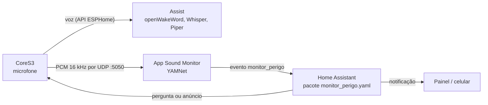

# Manual: app Sound Monitor no Home Assistant OS

Este manual cobre a parte do servidor: instalar o app **Sound Monitor** no Home Assistant OS,
configurar as reações do Home Assistant e ajustar a detecção. A parte do dispositivo está em
[manual-cores3-esphome.md](manual-cores3-esphome.md).

## Como as peças se encaixam



1. O CoreS3 transmite o áudio do microfone para o app por UDP, na porta 5050.
2. O app classifica o áudio com o YAMNet a cada 0,5 s. Quando confirma grito, latido, campainha,
   alarme de incêndio ou explosão, dispara o evento `monitor_perigo` no Home Assistant pela API
   interna do Supervisor. Não há webhook nem senha para configurar.
3. O pacote `monitor_perigo.yaml` recebe o evento, liga um sensor por categoria, cria uma
   notificação e, conforme a categoria, faz o CoreS3 perguntar "Está tudo bem?" ou anunciar a campainha.

## Requisitos

- Home Assistant OS **2026.2 ou mais recente** (quando os add-ons passaram a se chamar *apps*).
- Hardware de **64 bits** (amd64 ou aarch64: Raspberry Pi 4/5 com SO de 64 bits, mini-PC, VM,
  HA Green/Yellow). O runtime do modelo não existe para ARM de 32 bits.
- Cerca de 300 MB livres de RAM e 1 GB de disco para a imagem.
- O CoreS3 com o firmware deste projeto (veja o outro manual). Sem ele, o app roda, mas não recebe áudio.

## 1. Instalar o app

1. Em **Configurações → Apps**, clique em **Instalar app** para abrir a loja.
2. No menu **⋮** (canto superior direito), escolha **Repositórios**, cole a URL abaixo e clique em **Adicionar**:

   ```text
   https://github.com/avilarezende/cores3-ha-voice-monitor
   ```

3. Feche a janela e recarregue a loja. Aparece a seção **CoreS3 HA Voice Monitor** com o app **Sound Monitor**.
4. Abra o app e clique em **Instalar**. O Home Assistant constrói a imagem na própria máquina e
   baixa o modelo YAMNet. Num Raspberry Pi isso leva alguns minutos.
5. Na aba **Informações**, confira se **Iniciar na inicialização** está ativado e clique em **Iniciar**.
6. Abra a aba **Log**. O app está pronto quando aparecer:

   ```text
   INFO Parâmetros padrão copiados para /config/config.toml
   INFO Eventos serão disparados como 'monitor_perigo' pela API do Supervisor
   INFO Escutando PCM 16 kHz/16 bit/mono em UDP 5050
   INFO Categorias: grito, latido, campainha, alarme_incendio, explosao
   ```

   Quando o CoreS3 começar a transmitir, surge `Novo dispositivo transmitindo: <IP do CoreS3>`.
   A cada minuto o app registra quantos segundos de áudio recebeu. Se for perto de 60 s, não há perda na rede.

### Opções do app (aba Configuração)

| Opção | Padrão | Para que serve |
|---|---|---|
| Nível de log | `INFO` | `DEBUG` registra as 3 classes mais prováveis de cada janela analisada |
| Máximo de clipes | `200` | Quantos WAVs de eventos guardar; os mais antigos são apagados |

Em **Rede**, dá para trocar a porta UDP do host (padrão 5050). Se mudar, ajuste `sound_monitor_port` no firmware.

## 2. Configurar as reações no Home Assistant

O app só dispara o evento. Quem decide o que fazer é o pacote `homeassistant/packages/monitor_perigo.yaml`.

1. Instale um editor de arquivos pela loja de apps, por exemplo **Studio Code Server** ou **File editor**.
2. No `configuration.yaml`, ative os pacotes, se ainda não estiverem ativos:

   ```yaml
   homeassistant:
     packages: !include_dir_named packages
   ```

3. Crie a pasta `/config/packages/` e copie para ela **somente** o arquivo
   [`homeassistant/packages/monitor_perigo.yaml`](../homeassistant/packages/monitor_perigo.yaml).
   O `monitor_perigo_webhook.yaml` é só para quem roda o monitor fora do HA OS; não copie.
4. No arquivo copiado, troque o valor de `satellite` pela entidade do seu CoreS3. Ela fica em
   **Configurações → Dispositivos e serviços → ESPHome → CoreS3 Assist**, na entidade do tipo
   *Assist satellite* (algo como `assist_satellite.cores3_assist_a1b2c3_assist_satellite`).
5. Em **Configurações → Ferramentas de desenvolvedor → YAML** (antes da 2026.2, as ferramentas
   ficavam no menu lateral), clique em **Verificar configuração** e depois em **Reiniciar**.

Depois do reinício, aparecem estas entidades:

| Entidade | Tipo | Fica ligada por |
|---|---|---|
| Último perigo detectado | sensor (atributos: rótulo, confiança, dispositivo, clipe, horário) | até o próximo evento |
| Perigo: grito | binary_sensor (safety) | 60 s |
| Perigo: latido | binary_sensor (sound) | 60 s |
| Perigo: campainha | binary_sensor (sound) | 30 s |
| Perigo: alarme de incêndio | binary_sensor (smoke) | 5 min |
| Perigo: explosão | binary_sensor (safety) | 2 min |

### Reações padrão

| Categoria | Notificação | No CoreS3 |
|---|---|---|
| grito, alarme de incêndio, explosão | sim | pergunta "Atenção: detectei …. Está tudo bem?" e escuta a resposta |
| campainha | sim | anuncia "A campainha tocou." |
| latido | sim | nada |

Para mudar isso, edite a automação `monitor_perigo_reagir` no pacote. Para receber o aviso no
celular, acrescente uma ação `notify.mobile_app_<seu_celular>` ao lado da `persistent_notification.create`.
Outras automações também podem usar o evento `monitor_perigo` ou os sensores
(por exemplo, acender as luzes com alarme de incêndio).

## 3. Testar

### Sem som: simulando um evento

Isto testa o Home Assistant sem depender do microfone nem do modelo.

1. Vá em **Configurações → Ferramentas de desenvolvedor → Eventos**.
2. Em *Tipo de evento* digite `monitor_perigo` e em *Dados do evento*:

   ```yaml
   category: grito
   label: Screaming
   score: 0.9
   device: teste
   clip: ""
   ```

3. Clique em **Disparar evento**. Devem acontecer três coisas: a notificação aparece, o sensor
   **Perigo: grito** liga e o CoreS3 pergunta se está tudo bem.

### Com som

Toque perto do CoreS3, numa caixa de som em volume alto, um vídeo de latido ou de alarme de
fumaça. No log do app deve aparecer, por exemplo:

```text
WARNING PERIGO latido (Bark, 0.74) em 192.168.1.50
```

Não teste com o próprio CoreS3 tocando o som: enquanto o alto-falante toca, o microfone fica
pausado (veja *Limitações*).

## 4. Ouvir os clipes

Cada evento salva um WAV de 4 s com o som que o disparou. Abra **Mídia → Mídia local → sound-monitor**.
O nome do arquivo traz data, hora, categoria e confiança, por exemplo
`20261015-153031_latido_0.80.wav`. O atributo `clip` do sensor **Último perigo detectado** aponta
para o clipe do evento mais recente.

Os clipes são o melhor material para ajustar os limiares, e também para verificar alarmes falsos.

## 5. Ajustar a detecção

Os parâmetros ficam em `config.toml`, que o app copia na primeira execução para a pasta de
configuração dele. No Studio Code Server ou no app Samba, a pasta aparece como
`addon_configs/<id>_sound_monitor/` (em versões mais novas, `app_configs/…`).
Depois de editar, **reinicie o app**.

Além das categorias, o `config.toml` aceita três chaves globais (todas opcionais; o padrão do app 0.2.0 já as traz):

| Chave | Padrão | Efeito |
|---|---|---|
| `allowed_sources` | `[]` (qualquer IP) | Só classifica UDP vindo destes IPs. Um pacote de outra origem (por exemplo o roteador) é ignorado e logado uma vez |
| `min_fresh_fraction` | `0.9` | Exige que esta fração da janela de 0,975 s tenha chegado nos últimos 1,5 s. Pacotes soltos deixam o buffer velho e não vão ao YAMNet |
| `near_miss_fraction` | `0.0` (desligado) | Com log em `INFO`, quando uma categoria chega a esta fração do limiar o app registra as 5 classes mais prováveis. `DEBUG` continua mostrando toda janela |

Cada categoria pode, além dos parâmetros abaixo, vetar um acerto quando outro som domina — útil quando periquitos disparam a campainha. A janela deixa de contar se `veto >= veto_min` e `veto >= pontuação × veto_ratio`, a menos que algum rótulo em `strong_labels` passe de `strong_threshold` (um toque tonal claro ainda conta). Padrões: `veto_min` 0,15, `veto_ratio` 1,0, `strong_threshold` 1,1 (sem rótulos fortes, o veto não é anulado). Exemplo na categoria `campainha`, comentado no `config.toml` distribuído:

```toml
veto_labels = ["Bird", "Bird vocalization, bird call, bird song", "Chirp, tweet", "Squawk"]
veto_min = 0.15
veto_ratio = 1.0
strong_labels = ["Ding-dong"]
strong_threshold = 0.45
```

Quem já tem um `config.toml` editado não recebe essas chaves sozinho (o app só copia o arquivo na primeira execução). Vale acrescentá-las à mão e reiniciar o app. A versão do app precisa ser **0.2.0** ou mais nova.

Cada categoria tem quatro parâmetros:

| Parâmetro | Efeito | Se houver alarmes falsos | Se perder eventos reais |
|---|---|---|---|
| `threshold` | pontuação mínima do YAMNet (0–1) numa janela | aumentar | diminuir |
| `window` / `min_hits` | dispara com `min_hits` acertos nas últimas `window` janelas de 0,5 s | aumentar `min_hits` | diminuir `min_hits` |
| `cooldown_seconds` | intervalo mínimo entre dois eventos da mesma categoria | aumentar | diminuir |
| `labels` | classes do AudioSet que contam para a categoria | remover a classe que confunde | acrescentar classe parecida |

Os nomes válidos de `labels` estão no
[mapa de classes do YAMNet](https://github.com/tensorflow/models/blob/master/research/audioset/yamnet/yamnet_class_map.csv).
Exemplos úteis que não vêm ativados: `Glass`/`Shatter` (vidro quebrando), `Baby cry, infant cry`,
`Siren`, `Car alarm`. Também é possível criar categorias novas: basta acrescentar um bloco
`[categories.nome]`. Para o HA reagir a elas, acrescente um sensor e uma descrição no pacote.

O valor global `min_rms_dbfs` descarta janelas silenciosas antes do modelo. Se o CoreS3 estiver
longe da fonte de som, diminua esse valor (por exemplo, para `-75`).

### Como escolher os limiares

1. Mude o **Nível de log** do app para `DEBUG` e reinicie.
2. Reproduza o som que você quer detectar. O log mostra, a cada 0,5 s, as três classes mais
   prováveis com suas pontuações, por exemplo `Bark=0.74, Dog=0.89, Animal=0.92`.
3. Coloque o `threshold` da categoria um pouco abaixo das pontuações típicas do som real e acima
   das que aparecem com os sons normais da casa (TV, conversa, panelas).
4. Volte o log para `INFO`: o `DEBUG` gera muitas linhas.

Para analisar um clipe salvo com calma num PC com Docker (a partir da raiz do repositório):

```powershell
docker build -t sound-monitor ./sound-monitor
docker run --rm -v "${PWD}:/a" sound-monitor classify /a/20261015-153031_latido_0.80.wav
```

A saída mostra, janela a janela, as cinco classes mais prováveis, a pontuação de cada categoria e
os pontos em que um evento seria disparado com o `config.toml` atual.

## 6. Atualizar o app

O Home Assistant só oferece atualização quando o campo `version` de `sound-monitor/config.yaml`
muda no GitHub. A versão atual do app é **0.2.0**. Ao alterar o código do app, aumente a versão
(por exemplo, `0.2.0` → `0.2.1`) e publique. A atualização aparece em **Configurações → Apps**.
O `config.toml` editado e os clipes são preservados.

## Solução de problemas

| Sintoma | Causa provável | O que fazer |
|---|---|---|
| O app não aparece na loja | repositório não carregado | Na loja, menu ⋮ → **Verificar atualizações**; confira se a URL foi adicionada |
| A instalação falha | arquitetura de 32 bits ou sem internet | Confira em **Configurações → Sistema → Hardware**; a instalação baixa o modelo |
| O log nunca mostra "Novo dispositivo transmitindo" | o CoreS3 não está enviando | No CoreS3, confira as entidades "Monitor de sons perigosos" (ligada) e "Monitor de sons transmitindo" (ligada); confira `sound_monitor_host` = IP do HA |
| "Monitor de sons transmitindo" desligado | o Assist não está escutando: microfone mutado, CoreS3 desconectado do HA ou HA falando | Desmute; confira o pipeline do dispositivo |
| Bem menos que 60 s de áudio por minuto no log | Wi-Fi fraco ou congestionado | Aproxime o CoreS3 do roteador; os logs do CoreS3 mostram `Dropped N bytes` |
| Eventos no log, mas nada acontece no HA | pacote não carregado | Confira `packages` no `configuration.yaml`; teste com o evento simulado (seção 3) |
| Notificação aparece, mas o CoreS3 não fala | entidade `satellite` errada | Corrija a variável no pacote; veja o rastreamento da automação `monitor_perigo_reagir` |
| `Falha ao avisar o Home Assistant` no log | sem `homeassistant_api` ou HA reiniciando | Reinicie o app depois do HA |
| Muitos alarmes falsos | limiar baixo para o seu ambiente | Seção 5; ouça os clipes para ver o que disparou |
| Log `Ignorando áudio de <IP>` | UDP de um aparelho fora de `allowed_sources` | Inclua o IP do CoreS3/StickS3 na lista, ou esvazie a lista para aceitar todos |
| Campainha dispara com pássaros | YAMNet confunde canto com toque | `veto_labels` na categoria (seção 5); um toque forte continua valendo via `strong_labels` |
| Alarme falso horas depois do último som real | Pacotes soltos preenchem um buffer antigo e o YAMNet pontua o resto | `allowed_sources` e `min_fresh_fraction` (seção 5); no 0.2.0 isso já vem ligado para fração 0,9 |

## Limitações

- **O monitor só escuta quando o Assist escuta.** O microfone e o alto-falante do CoreS3 dividem o
  mesmo barramento de áudio. O monitor fica pausado enquanto o HA fala, com o microfone mutado e
  quando o CoreS3 perde a conexão com o HA.
- **O YAMNet é um modelo genérico.** Ele foi treinado com vídeos do YouTube, não com a sua casa.
  O alcance depende muito da distância e do volume, e explosões e gritos têm mais variação que alarmes e latidos.
  Os limiares padrão são um ponto de partida, não valores calibrados.
- **Não substitui um detector de fumaça certificado.** É um alerta complementar.
- **Privacidade:** o áudio trafega sem criptografia pela rede local (UDP) e só é gravado em disco
  nos clipes de eventos. Nada sai da sua rede. Desligar o switch "Monitor de sons perigosos"
  interrompe a transmissão para o app sem afetar o assistente de voz.
